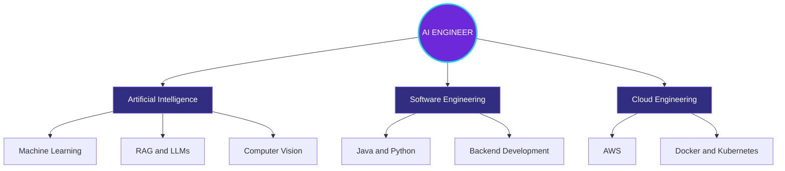
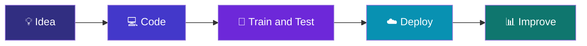

# <div align="center">🧠 SELAM1431 | AI COMMAND CENTER</div>

<div align="center">
  
</div>

<div align="center">
  
</div>

<div align="center">
  
  
  
</div>

---

## 👩🏽‍💻 About Me

```python
developer = {
    "name": "Selamawit",
    "username": "Selam1431",
    "education": "Bellevue College",
    "major": "Software Development - Artificial Intelligence",
    "focus": ["AI", "Machine Learning", "Backend", "Cloud"],
    "currently_building": "Intelligent software applications",
    "currently_learning": ["Java", "Computer Vision", "System Design"],
    "mission": "Build technology that solves real problems"
}
```

I'm an AI-focused Software Development student at **Bellevue College**, passionate about creating intelligent applications, machine learning systems, and scalable software.

---

## 🧠 Neural Engineering Network



---

## ⚙️ Engineering Pipeline



---

## 🛠️ Tech Stack

### Programming Languages


### Artificial Intelligence & Machine Learning


### Software, Tools & Cloud


---

## 🚀 Featured Projects

| 🧠 Project | 💡 Description | ⚙️ Technologies |
|---|---|---|
| [RAG Document Search](https://github.com/Selam1431/Rag-Document-Search) | AI-powered document search using retrieval-augmented generation | Python, Ollama, ChromaDB |
| [Stock Direction ML](https://github.com/Selam1431/stock-direction-ml) | Predicting stock price direction with machine learning | Python, ML |
| [WorkBook-2](https://github.com/Selam1431/WorkBook-2) | Java exercises covering OOP, file handling and collections | Java |
| [NeetCode Submissions](https://github.com/Selam1431/neetcode-submissions) | Data structures and algorithm problem solving | Python |

---

## 📊 GitHub Command Center

<div align="center">
  
  
</div>

<div align="center">
  
</div>

### 📈 Contribution Activity

<div align="center">
  
</div>

---

## 🎯 Current Mission

- 🧠 Build practical AI and machine learning applications
- 💻 Strengthen Java, Python and backend engineering skills
- 🔍 Explore computer vision, RAG and LLM systems
- ☁️ Learn scalable cloud architecture
- 🧩 Practice data structures and algorithms
- 🚀 Grow as an AI and Software Engineer

---

## 🌐 Connect With Me

<div align="center">

[](https://github.com/Selam1431)

</div>

<div align="center">
  
</div>
